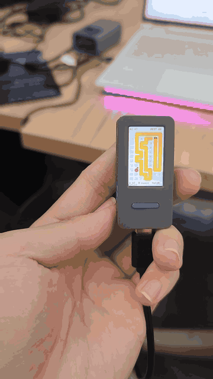

<div align="center">

# StickS3 Tilt Snake

**Snake you steer by tilting the board. Or press one key and let the AI play it for you.**

[English](README.md) · [简体中文](README.zh-CN.md)



</div>

## What this is

A complete Snake game for the M5Stack StickS3, written as a single PlatformIO project on top of M5Unified. The board is 7 × 11 cells on a 135 × 240 screen, drawn as light cards: a continuous yellow body, a red apple, the previous run's trail as faint dots behind it.

It has two modes, and the second one is the point of the project:

- **Manual.** Tilt the device to steer. A direction only registers when the tilt passes 0.30 g *and* the dominant axis is 1.4× the other one, which is what keeps the snake from twitching when your hand shakes.
- **AI.** Press **A** and the game plays itself, drawing its plan on the board while it goes.

## Controls

| Input | While playing | On the game-over screen |
|:--|:--|:--|
| Tilt | Steer (manual mode) | Recalibrates on the next manual start |
| **A** (short) | Hand control to the AI | Start a new game in AI mode |
| **B** (short) | Pause / resume | — |
| **B** (hold) | Take control back from the AI | Start a new game in manual mode, after a 1.2 s recalibration |

The top bar shows the current mode, the score, and the best score, which survives a reboot.

## How the AI plays

Each tick the AI runs through four checks, in this order:

1. **BFS to the apple.** The body blocks the search, except the tail cell, which will have moved by the time the head gets there. The resulting path is drawn as blue dots.
2. **Can it still reach its own tail after eating?** It simulates the first step, then asks whether the head can still reach the tail. If not, the move would seal the snake into a pocket, so it is rejected.
3. **Starving.** After 40 ticks without food, step 2 is skipped and the AI takes the apple anyway. This is a deliberate gamble: better to risk a trap than to loop forever.
4. **No path to the apple.** The AI heads for its own tail to untangle itself, and if even that fails, it picks the neighbouring cell with the largest reachable area, to take the least-bad move.

In AI mode the board also shows the four cells next to the head that would trap it, so you can see the decision being made rather than just the result.

Measured once during development: **41 apples, 44 segments, no deaths in a 4-minute window** of continuous AI play on a 77-cell board. "No deaths" means it happened not to die in that window, not that it cannot: when every move is bad, it still takes one of them. The serial log from that run was a temporary file and is not in this repository.

A second run on the board, after the AI logic moved into `game/ai.cpp` (v0.1.1): **40 apples, 43 segments**. It went 69 ticks without food before taking the starvation gamble, won one more apple, and died by self-collision. That is the designed outcome, not a regression: the gamble trades safety for a single apple. On the same unit, a best score of 52 survived a power cycle.

## Hardware

| | |
|:--|:--|
| Board | M5Stack StickS3 |
| SoC | ESP32-S3-PICO-1-N8R8, dual-core LX7 @ 240 MHz |
| Memory | 8 MB flash, 8 MB octal PSRAM |
| Display | ST7789, 135 × 240, offset (52, 40), inverted |
| Input | Button A on GPIO11, button B on GPIO12, IMU for tilt |
| Audio | ES8311 codec with AW8737 amplifier |
| Battery | 250 mAh with M5PM1 power management |

Two details that cost time and are worth knowing before you flash anything:

- **Unplugging USB does not power the board off.** There is a battery. To reboot, double-click the side power key to shut down, then single-click to start.
- **The board can sit in the ROM bootloader after a failed flash.** Software reset will not get it out. The same double-click / single-click sequence will.

## Build and flash

You need [PlatformIO Core](https://docs.platformio.org/en/latest/core/installation/) (`pio`) and a USB-C data cable.

```bash
cd sticks3-play
pio run -t upload
```

With the firmware running normally, the upload is fully automatic: esptool enters download mode and resets the board by itself. If the board is already stuck in the bootloader, power-cycle it as described above and retry.

To compile without uploading:

```bash
cd sticks3-play
pio run
```

The project pins `platform = espressif32@6.12.0`, `board = esp32-s3-devkitc-1`, the `default_8MB.csv` partition table, and `qio_opi` memory type. The only library dependency is M5Unified.

If you use Arduino CLI instead, the workshop reference configuration was:

```text
esp32:esp32:esp32s3:USBMode=hwcdc,CDCOnBoot=cdc,FlashSize=8M,PartitionScheme=default_8MB,PSRAM=opi
```

That FQBN comes from the event material and has **not** been re-verified against this repository; the PlatformIO path above is the one this project is developed and tested with.

## Repository layout

```text
sticks3-play/     firmware: game/ai.* is pure logic, main.cpp is the device layer
tests/            host-side AI tests, built with plain g++
docs/assets/      images used by the READMEs
tools/            serial and flashing helpers
```

## Known limitations

- **The grid is compiled in.** 7 × 11 and an 18 px cell are constants in `main.cpp`; changing them changes the layout, not just the difficulty.
- **Tilt wants a level surface.** The neutral position is sampled for 1.2 s at boot, and again when a manual game starts after a death. Move the board during that window and the controls will feel offset.
- **The AI is tested off-device.** Its logic sits in `sticks3-play/src/game/ai.cpp` with no M5Stack dependency; `tests/test_ai.cpp` covers the pocket, tail-chase and starvation rules under plain g++. The display, IMU and input paths are still verified on the board.

## Origin

Built at Qoder Hardware Lab, Beijing, on 2026-10-24, as a one-day project: bring up a bare StickS3, then make something worth demoing.

## License

MIT. See [LICENSE](LICENSE).