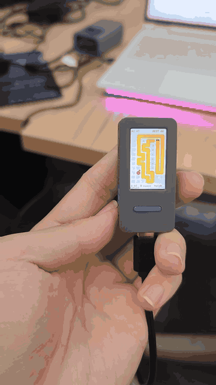

<div align="center">

# StickS3 倾斜贪吃蛇

**倾斜板子来转向的贪吃蛇。或者按一个键，交给 AI 自己玩。**

[English](README.md) · [简体中文](README.zh-CN.md)



</div>

## 这是什么

一个跑在 M5Stack StickS3 上的完整贪吃蛇，基于 M5Unified 的单个 PlatformIO 工程。棋盘 7 × 11 格，屏幕 135 × 240，浅色卡片风格：连续的黄色蛇身、红苹果，上一局的轨迹会以浅灰圆点留在背后。

它有两种模式，第二种才是这个项目真正想展示的东西：

- **手动**：倾斜设备转向。只有当倾角超过 0.30 g，且主轴分量是另一轴的 1.4 倍以上时才换向，这是为了抑制手抖导致的横跳。
- **AI**：按 **A** 交给托管。它会一边走，一边把自己的计划画在棋盘上。

## 操作

| 操作 | 游戏中 | 结束画面 |
|:--|:--|:--|
| 倾斜 | 转向（手动模式） | 下一次手动开局时重新标定 |
| **A** 短按 | 把控制权交给 AI | 以 AI 模式开一局 |
| **B** 短按 | 暂停 / 继续 | — |
| **B** 长按 | 从 AI 手里收回手动控制 | 标定 1.2 秒后以手动模式开一局 |

顶栏显示当前模式、本局分数和最高分；最高分写进 NVS，重启后还在。

## AI 怎么玩

每一步，AI 按顺序过四道检查：

1. **BFS 找苹果。** 身体算障碍，但尾巴那一格不算：等蛇头走过去时，尾巴已经让开了。搜出来的路径会画成蓝色小点。
2. **吃完还找得回自己的尾巴吗？** 先推演一步，再问蛇头还能不能碰到尾巴。碰不到，说明这一步会把蛇封进死角，放弃。
3. **饿太久了。** 连续 40 步没吃到东西时，跳过第 2 条，直接扑向苹果。这是故意的赌博：与其原地绕圈，不如冒一次险。
4. **根本走不到苹果。** 先追自己的尾巴，把身体解开；连尾巴都追不到，就在四个方向里选可达空间最大的一个，也就是最不坏的一步。

AI 模式下，蛇头四周"走进去会死"的格子会标红。你能看见它怎么判断，而不只是看见结果。

开发期间的一次实测：**4 分钟窗口内 41 个苹果、长度 44 节、零死亡**，棋盘一共 77 格。「零死亡」指这四分钟里恰好没死，不是能力上限：四个方向都不安全时，它仍然会挑一步走。那次的串口日志当时放在临时目录，没有入库。

AI 逻辑抽进 `game/ai.cpp` 后又实测一局（v0.1.1）：**40 个苹果、长度 43 节**。这局连续 69 步没吃到东西才触发饥饿兜底，赌到一颗苹果，随后自撞结束。这是设计内的结果，不是回归：兜底本来就用安全换一颗苹果。同一台机器上，最高分 52 断电重启后仍在。

## 硬件

| | |
|:--|:--|
| 板子 | M5Stack StickS3 |
| SoC | ESP32-S3-PICO-1-N8R8，双核 LX7 @ 240 MHz |
| 存储 | 8 MB flash + 8 MB octal PSRAM |
| 屏幕 | ST7789，135 × 240，偏置 (52, 40)，反色开启 |
| 输入 | A 键接 GPIO11，B 键接 GPIO12，倾斜用 IMU |
| 音频 | ES8311 codec + AW8737 功放 |
| 电池 | 250 mAh，配 M5PM1 电源管理 |

有两个坑烧板之前值得先知道：

- **拔掉 USB 不等于断电。** 板上有电池。要重启，双击侧边电源键关机，再单击开机。
- **烧写失败后，芯片可能停在 ROM bootloader 里。** 软件复位救不回来，同样走双击关机、单击开机。

## 编译与烧写

需要 [PlatformIO Core](https://docs.platformio.org/en/latest/core/installation/)（`pio`）和一根能传数据的 USB-C 线。

```bash
cd sticks3-play
pio run -t upload
```

固件正常运行的情况下，烧写全自动：esptool 自己进下载模式，烧完自己复位。如果板子已经卡在 bootloader，先按上面的办法关机再开机，然后重试。

只编译不烧写：

```bash
cd sticks3-play
pio run
```

工程固定了 `platform = espressif32@6.12.0`、`board = esp32-s3-devkitc-1`、`default_8MB.csv` 分区表和 `qio_opi` 内存类型，唯一的库依赖是 M5Unified。

如果改用 Arduino CLI，活动材料里的参考配置是：

```text
esp32:esp32:esp32s3:USBMode=hwcdc,CDCOnBoot=cdc,FlashSize=8M,PartitionScheme=default_8MB,PSRAM=opi
```

这个 FQBN 来自活动资料，**没有**在本仓重新验证过；本项目开发和验证走的是上面的 PlatformIO 路径。

## 目录结构

```text
sticks3-play/     固件：game/ai.* 是纯逻辑，main.cpp 是设备层
tests/            AI 的 host 测试，用系统 g++ 编译
docs/assets/      README 用到的图片
tools/            串口与烧写辅助脚本
```

## 已知限制

- **棋盘是编译期常量。** 7 × 11 和 18 px 的格子写在 `main.cpp` 里，改它们等于改布局，不只是改难度。
- **倾斜需要相对水平的面。** 开机时采样 1.2 秒确定中位，死亡后开始手动局时会再采一次。这 1.2 秒里挪动板子，方向就会偏。
- **AI 有 host 测试。** 决策逻辑在 `sticks3-play/src/game/ai.cpp`，不依赖 M5Stack；`tests/test_ai.cpp` 用普通 g++ 覆盖封死口袋、追尾、饥饿兜底三条规则。屏幕、IMU 和按键仍然靠上板验证。

## 来历

2026-10-24 于北京 Qoder Hardware Lab 现场完成：一天之内把一块空板子点亮，再做出一件能拿出去演示的东西。

## 许可证

MIT，见 [LICENSE](LICENSE)。